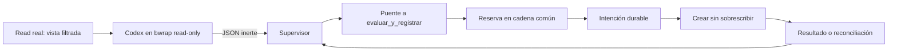

# Ejecutor externo de creación para Codex

| Requisito | Fuente | Evidencia |
|---|---|---|
| Separar propuesta, puerta real y aplicación | Encargo del ejecutor, 2026-10-29; diseño y prerregistro de Labs de esa fecha | `adaptadores/codex/ejecutor/`; JSON por stdin al puente; `evaluar_y_registrar` intacta |
| Fuera del ámbito nunca se aplica; dentro sí | Encargo, casos positivos y negativos | Codex real: fichero con bytes exactos, fuera del glob y fuera de raíz sin destino |
| Puerta muerta, agotada o en excepción falla cerrada | Encargo G13 | Misma propuesta real en tres fixtures de fallo, sin destino; también ausencia, respuestas inválidas y descendientes en tests |
| Evidencia y reservas reales, sin alterar la puerta | Diseño de Labs y restricción del encargo | Cadena común del contrato, reserva contada una vez, intención durable, reconciliación y corrupción/pending bloqueantes |
| Como máximo seis llamadas, Terra medium y auth temporal | Encargo del ensayo | Seis llamadas; campaña final 4–6 con fuentes verificadas por SHA-256; hogares borrados |
| No modificar núcleo ni publicar desde el worker | Restricción específica del sandbox | Cambios solo en adaptador, pruebas, documentación y changelog; entrega en worktree |

Las PR #19 y #20 están incorporadas en `99f26cf`, base de esta entrega. No existe
`MAP.md` en este checkout; la implementación amplía el adaptador ya establecido.
El diseño de Labs era una simulación; esta entrega sustituye su puerta por el
núcleo real, con presupuesto, firma sintética y evidencia común. No copia al repo
datos privados de Labs ni de la persona.

## Resultado medido

[Resumen verificable y hashes](codex-ejecutor-resultados.json).
**G13 y G14 quedan cerradas para creación externa de un fichero nuevo.**
La [matriz](codex-garantias.md) cuenta 13/15 compatibles en ese alcance;
G12 y G15 siguen abiertas. No certifica equivalencia general ni repara los
hooks/editor nativos de Codex.

| Comprobación | Resultado |
|---|---|
| Tests nuevos | 38 pasan; cada uno detecta al menos una mutación por aserción |
| Mutaciones del adaptador en copias | 34/34 detectadas; no cuentan errores, importaciones, sintaxis ni omitidos |
| Batería general | 371 ejecutados: 359 pasan y 12 omitidos preexistentes por confianza de bwrap del núcleo |
| Caja nueva | Pruebas efectivas ejecutadas, sin omitir: snapshot inmutable, autoridad invisible y montaje escribible detectado |
| Ensayo Codex | CLI 0.163.0, `gpt-6.1-terra`, `medium`, `never`, `read-only`, sin hooks; 6/6 llamadas |
| Permitido E2 | `src/permitido.txt` existe con `sonda correcta.\n` y consume exactamente un efecto |
| Negativos E2 | `src/fuera.txt` y `../FUERA` no existen; propuestas reales con esas rutas, cero efectos consumidos |
| Fallos de puerta | Muerte, timeout y excepción: rechazo, sin destino, cadena íntegra |
| Evidencia | Hashes válidos en todas las fixtures; recibo del núcleo enlazado con efecto, contrato y política |

Las llamadas 1–3 probaron la primera implementación. Tras la autorrevisión se
añadió el bloqueo de pendientes entre contratos y la reconciliación después de
revocar. Las llamadas 4–6 repiten los tres casos con las fuentes finales; sus
manifiestos coinciden con el del validador de mutaciones. Seis llamadas en total,
sin reiniciar el contador. No se llama al modelo para simular fallos de puerta.

Antes, el editor nativo del ensayo de #20 no creaba el fichero concedido.
Ahora el aplicador externo sí lo crea. Cambia la arquitectura: no se atribuye
esta mejora al editor del CLI ni se compara latencia entre ambos recorridos.

## Autoridad y recorrido



Propuesta admitida, máximo 16 KiB UTF-8:

```json
{"version":1,"id":"p-001","tipo":"crear","ruta":"src/nueva.txt","contenido":"hola\n"}
```

Esquema cerrado, sin claves repetidas ni extras, `NaN`, versiones booleanas,
rutas absolutas, componentes vacíos, `..`, enlaces o operaciones desconocidas.
El modelo no elige contrato, raíz, puerta, timeout ni permiso. Cada id de propuesta
válida se consume dentro de su contrato incluso si la puerta la rechaza. Las
inválidas se auditan por hash, sin guardar el contenido. Solo se crean ficheros
nuevos y sus padres deben existir.

El supervisor fija la configuración. El puente reconstruye `Write`, cwd real y
`dontAsk`; llama a `evaluar_y_registrar` con el estado dedicado. Solo `ok is True`
autoriza: `PREGUNTAR`, `1`, rc no cero, silencio, JSON inválido, nonce/huella/vínculo
distintos, ausencia o timeout deniegan. Se mata el grupo de procesos del hijo.
La respuesta incorpora el hash de la reserva real; una respuesta sin ella no
permite escribir. La CLI no ofrece un argumento para sustituir la puerta.

Se añaden a la misma cadena del núcleo `propuesta`, `autorizada`, `intencion` y
`aplicada`, o `rechazada`. El vínculo fija id/versión/huella de contrato, huella
del contrato completo y política. Los registros adicionales no vuelven a cobrar
el efecto. Se verifica la cadena y se hace fsync de fichero y directorio antes
de aplicar. Un recibo permitido es una reserva conservadora: nunca se reembolsa
porque la aplicación falle.

El aplicador abre componentes con `dir_fd` y `O_NOFOLLOW`, prepara un temporal
después del permiso y publica por `link` exclusivo. Revalida vigencia, contrato,
política, inode del directorio y plazo antes de publicar. Nunca reemplaza un
destino creado por otra escritora. Núcleo y adaptador están protegidos.

La caja externa monta `/usr`, el paquete standalone de Codex, ficheros de DNS/CA,
la vista filtrada en `/w` y el hogar efímero en `/h`. Aísla procesos y montajes;
no monta workspace, estado ni hogar original. El preflight comprueba ausencia
de autoridad y rechazo efectivo de escritura antes de cada llamada. Si falta
bwrap, falla o cambia el CLI auditado, no arranca Codex. No hay fallback sin caja.
La copia de auth solo vive en el hogar temporal privado y se elimina al salir,
también ante excepción. No se modifican las credenciales originales.

Las lecturas son una lista explícita: cada fichero pasa por `Read` del núcleo,
sin enlaces, ficheros especiales, credenciales o configuración de proyecto.
La vista conserva sus bytes y hashes, sin enlaces al origen; se renueva cada
turno. El siguiente prompt recibe el resultado del turno anterior. No se concede
shell ni una herramienta de escritura al modelo.

## Uso y reproducción

Requiere Linux con bwrap operativo, Python 3.11+, distribución standalone de
Codex 0.163.0 y contrato vigente aprobado por la persona. No crea ni aprueba
contratos de producción. Los argumentos proceden de la operadora, nunca del JSON.
`--estado` debe ser dedicado y separado del workspace; la política corresponde
a `--yema`. Ejecutar desde la raíz del repo:

```sh
python3 -m adaptadores.codex.ejecutor --yema "$YEMA_FUENTES" --estado "$ESTADO_DEDICADO" --trabajo "$WORKSPACE" sesion --salida "$LOG_PRIVADO" --leer contexto.txt --turnos 2 'Encargo aprobado'
python3 -m adaptadores.codex.ejecutor --yema "$YEMA_FUENTES" --estado "$ESTADO_DEDICADO" --trabajo "$WORKSPACE" reconciliar
python3 -B -m unittest discover -s pruebas -p 'test_codex*.py' -v
python3 -B pruebas/mutar_codex_ejecutor.py --salida "$LOG_PRIVADO/mutaciones.json"
```

`aplicar` recibe una propuesta por stdin para integración con un supervisor
confiable. No debe exponerse como herramienta del modelo. Retornos: 0 = resultado
completado, 2 = rechazo (también si un turno de sesión fue rechazado), 3 = detenida
y requiere inspección. Un retorno del modelo 0 nunca sustituye los checks E2.

`pruebas/ensayo_codex_ejecutor.py --salida "$CAMPANA" --caso dentro|fuera-glob|fuera-raiz`
prepara contratos y claves sintéticos y cuenta cada invocación antes de iniciar
el CLI. No se ejecuta al descubrir tests. **Esta campaña ya agotó sus seis llamadas;
reproducirla requiere una autorización nueva**, no otro directorio para eludir
el contador. Los scripts de cierre de Savia no existen en el repo Yema; no se
declara su ejecución ni commit/push/PR por este worker.

## Supuestos, riesgos y decisiones abiertas

**Supuestos:** operadora, binarios y ancestros de configuración confiables; estado
dedicado a este ejecutor, sin CLI/Claude simultáneos, sin cambio hostil de
directorios ni gobierno durante una transacción. El bloqueo serializa ejecutores
cooperantes; el núcleo y su CLI no adoptan ese bloqueo en esta entrega.

Un fallo previo a publicar no aplica el destino. **Después de publicar, una
excepción no puede deshacer de forma atómica un fichero ya autorizado.** Queda
intención pendiente y la sesión se detiene. `reconciliar` observa ausencia o hash
exacto, encadena el resultado y conserva la reserva; no reintenta ni escribe el
destino. Funciona tras caducidad/revocación y con otro contrato activo; si cambió
el material histórico o hay contenido distinto/enlace, exige inspección humana.
Pendientes o cadenas corruptas de cualquier contrato bloquean nuevas propuestas.
Un corte puede dejar un temporal autorizado `.yema-*`; su limpieza exige
inspección, no se borra a ciegas.

No se promete atomicidad distribuida ni plazo duro frente a E/S bloqueada. La
cadena no es una firma y necesita ancla externa para detectar retirada completa
de sufijos. La reconciliación no certifica quién creó un fichero con los mismos
bytes. La política filtra lecturas por rutas, no clasifica semánticamente todo
su contenido.

La caja comparte red para el proveedor; falta un proxy de destino único. El hogar
efímero con auth es accesible al proceso CLI; no se afirma una separación interna
entre CLI y todo posible código nativo. No se certifican catálogo completo ni
vías laterales remotas (G12), ni transporte/exclusividad MCP (G15). Edición,
borrado, recetas de órdenes, reservas entre adaptadores y supervisión con cgroup
quedan pendientes. El lanzador nativo continúa restringido.
